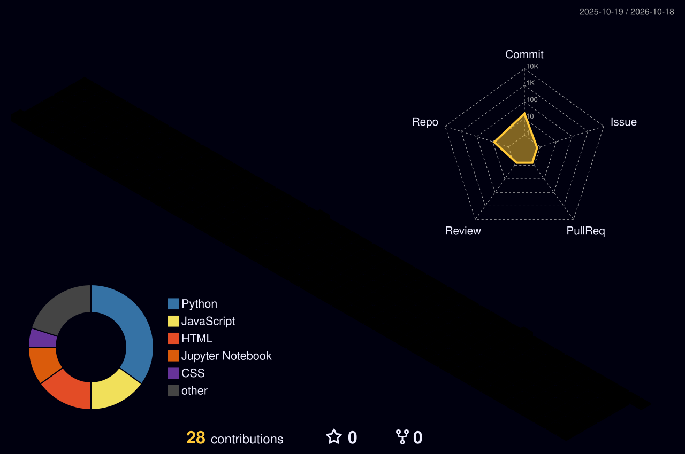

## 🌟 About Me
- 🎓 B.Tech in Computer Science & Engineering
- 🎯 Focused on **AI, ML and Data Science**
- 💡 Exploring **deep learning** and **data-driven projects**
- 📫 Reach me at: **your-email@example.com**

## 🧊 3D Contribution Graph

## 🛠️ Tech Stack

  

## 🚀 Featured Projects
| Project | What it does | Stack |
|---|---|---|
| [Restaurant Recommendation](https://github.com/uppiii/Restaurant_Recommendation) | Recommendation engine for restaurants | Python, ML |
| [ML Project](https://github.com/uppiii/ML_project) | ML pipeline with a web front end | Python, HTML |
| [Scrappie](https://github.com/BharathkumarR07/scrappie) | Garbage recycling & collection website | HTML, CSS, JS |
| [Quiz Application](https://github.com/uppiii/QUIZ_APPLICATION) | Interactive quiz app | JavaScript |
| [Password Generator](https://github.com/uppiii/PASSWORD_GENRATOR) | Random password generator | HTML, CSS, JS |
| [Cartoon Snake Game](https://github.com/uppiii/-Cartoon-Snake-Game) | Classic snake game | Python |

## 📊 GitHub Stats

  
  

## 🐍 Contribution Snake

